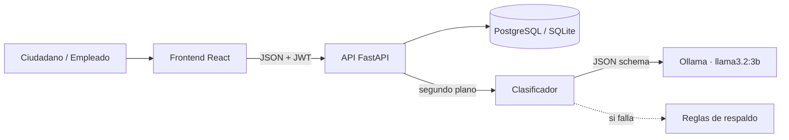

# Sistema Inteligente de Gestión de PQRS (prototipo funcional)

Aplicación web que recibe **peticiones, quejas, reclamos y sugerencias**, las **clasifica automáticamente con un modelo Llama ejecutado localmente con Ollama** (tipo, categoría, prioridad y resumen), las envía al área responsable y permite al equipo gestionarlas con trazabilidad completa.

> Proyecto de Software · Ingeniería de Software · Corporación Universitaria Iberoamericana
> Tipo de prototipo: **evolutivo, vertical y de alta fidelidad**: implementa de punta a punta el flujo crítico definido en los criterios de aceptación y es la base del MVP.

   

---

## Qué demuestra el prototipo

| Criterio de aceptación (Actividad 2) | Dónde se ve en el prototipo | Prueba automática |
|---|---|---|
| CA1. El usuario crea una cuenta, inicia sesión y radica una PQRS | Pantallas *Crear cuenta*, *Iniciar sesión* y *Radicar PQRS* | `test_ca1_*` |
| CA2. La solicitud se guarda íntegra y segura | Radicado único `PQRS-AAAA-000000`, contraseñas con PBKDF2, JWT | `test_ca2_*` |
| CA3. El backend envía el texto a la IA y recibe JSON estructurado | Panel *Análisis automático* (modelo y tiempo de respuesta) | `test_ca3_ca4_*`, `test_clasificador.py` |
| CA4. Se guardan tipología, prioridad y resumen sin intervención humana | Bandeja ordenada por prioridad; evento "Clasificación automática" | `test_ca4_*` |
| CA5. El empleado ve las PQRS de su área y gestiona su estado | *Bandeja* → *Tomar caso* → *Responder* → *Cambiar estado* | `test_ca5_*` |
| CA6. El cliente ve las actualizaciones en el historial | *Mis solicitudes* → *Seguimiento* | `test_ca6_*` |

Además: corrección humana de la clasificación, notas internas, plazo de respuesta en días hábiles (Ley 1755 de 2015), alertas de vencimiento y panel de métricas para la gerencia.

---

## Arquitectura



Diagramas completos (componentes, secuencia, entidad-relación, estados) y decisiones de diseño: **[docs/ARQUITECTURA.md](docs/ARQUITECTURA.md)**.

| Capa | Tecnología |
|---|---|
| Frontend | React 19, Vite, Tailwind CSS 4, React Router |
| Backend | Python 3.11+, FastAPI, SQLAlchemy 2, Pydantic 2, PyJWT |
| IA | Ollama + Llama 3.2 3B (local, sin enviar datos a terceros) |
| Base de datos | SQLite (desarrollo) · PostgreSQL 16 (Docker) |
| Pruebas | Pytest (unitarias e integración), Playwright (E2E con capturas) |

---

## Instalación

### Opción A: Docker (un solo comando)

Requisito: [Docker Desktop](https://www.docker.com/products/docker-desktop/).

```bash
docker compose up --build
```

- Aplicación: <http://localhost:8080>
- API y documentación interactiva (Swagger): <http://localhost:8000/docs>

La primera vez se descarga el modelo (≈2 GB). Mientras tanto el sistema funciona y clasifica con las reglas de respaldo; el indicador de la barra superior cambia a verde cuando la IA está lista.

### Opción B: Manual en Windows (PowerShell)

Requisitos: [Python 3.11+](https://www.python.org/downloads/), [Node.js 20+](https://nodejs.org/) y [Ollama](https://ollama.com/download).

**1. Modelo de IA**

```powershell
ollama pull llama3.2:3b
```

> ¿Equipo con poca memoria? Usa `ollama pull llama3.2:1b` y antes de iniciar el backend ejecuta `$env:OLLAMA_MODELO="llama3.2:1b"`.

**2. Backend** (terminal 1)

```powershell
cd backend
python -m venv .venv
.\.venv\Scripts\Activate.ps1      # si Windows lo bloquea: Set-ExecutionPolicy -Scope CurrentUser RemoteSigned
pip install -r requirements.txt
uvicorn app.main:app --reload
```

La API queda en <http://localhost:8000/docs>. La primera vez crea `pqrs.db` con datos de demostración.

**3. Frontend** (terminal 2)

```powershell
cd frontend
npm install
npm run dev
```

Abre <http://localhost:5173>.

### Usuarios de prueba

| Rol | Correo | Contraseña |
|---|---|---|
| Ciudadano | cliente@demo-pqrs.co | Cliente123* |
| Empleado · Facturación y Cartera | facturacion@demo-pqrs.co | Empleado123* |
| Empleado · Soporte Técnico | soporte@demo-pqrs.co | Empleado123* |
| Empleado · Atención al Cliente | atencion@demo-pqrs.co | Empleado123* |
| Administrador (ve todo + métricas) | admin@demo-pqrs.co | Admin123* |

En la pantalla de inicio de sesión, un clic sobre cada usuario llena el formulario. **Son credenciales solo para la demo.**

---

## Recorrido de demostración (5 minutos)

1. Entra como **ciudadano**, ve a *Radicar PQRS* y escribe, por ejemplo: *"Me cobraron dos veces la factura de noviembre en mi tarjeta. Solicito el reembolso."*
2. Observa el radicado y el estado *Analizando…*; en segundos aparecen el tipo y el área responsable.
3. Sal y entra como **empleado de Facturación**: la PQRS aparece en la bandeja con su prioridad.
4. Ábrela: revisa el **análisis de la IA** (resumen, justificación, modelo y tiempo). Pulsa *Tomar caso*, responde y márcala como *Resuelto*.
5. Vuelve como **ciudadano**: el seguimiento muestra cada cambio y la respuesta.
6. Entra como **administrador** y abre *Métricas*.

---

## Pruebas y evaluación

**Pruebas del backend** (unitarias + integración por criterio de aceptación):

```powershell
cd backend
pytest -v
```

**Precisión de la IA** contra 20 PQRS etiquetadas a mano ([evaluacion/dataset_pqrs.json](backend/evaluacion/dataset_pqrs.json)):

```powershell
python evaluacion/evaluar_clasificador.py --modo ia       # Llama vía Ollama
python evaluacion/evaluar_clasificador.py --modo reglas   # respaldo, para comparar
```

Genera `evaluacion/resultados_ia.md` con la tabla de aciertos por campo y por caso.

> Nota metodológica: las reglas de respaldo se escribieron conociendo este dataset, así que su puntaje es optimista. Para comparar con justicia, agrega casos nuevos al JSON que no hayas visto antes.

**Prueba E2E con capturas de pantalla** (con el sistema corriendo):

```powershell
pip install -r e2e/requirements.txt
playwright install chromium
pytest e2e -s                                            # modo manual (puerto 5173)
$env:E2E_BASE_URL="http://localhost:8080"; pytest e2e -s # modo Docker
```

Recorre registro → radicación → clasificación → gestión → respuesta → seguimiento → métricas y guarda 9 pantallazos en `docs/capturas/`. Con `$env:E2E_VER="1"` se ve el navegador mientras trabaja.

---

## Estructura del repositorio

```
pqrs-ia/
├── backend/
│   ├── app/
│   │   ├── main.py              # arranque, salud y catálogo
│   │   ├── models.py            # áreas, usuarios, pqrs, historial
│   │   ├── schemas.py           # contratos de entrada/salida
│   │   ├── security.py          # contraseñas y JWT
│   │   ├── routers/             # auth · pqrs (ciudadano) · gestion (backoffice)
│   │   └── services/
│   │       ├── clasificador.py  # IA con Ollama + respaldo por reglas
│   │       ├── catalogo.py      # tipos, categorías, áreas, estados
│   │       ├── flujo.py         # reglas de negocio y trazabilidad
│   │       └── plazos.py        # días hábiles y radicado
│   ├── evaluacion/              # dataset etiquetado y script de precisión
│   └── tests/                   # pytest
├── frontend/src/
│   ├── pages/cliente/           # mis solicitudes, radicar, seguimiento
│   ├── pages/gestion/           # bandeja, detalle con IA, métricas
│   └── components/              # layout, línea de tiempo
├── e2e/                         # Playwright + capturas
├── docs/ARQUITECTURA.md
└── docker-compose.yml
```

---

## Limitaciones conocidas y siguiente iteración

- El plazo en días hábiles no descuenta festivos colombianos.
- Las tablas se crean al iniciar (`create_all`); la siguiente iteración incorpora migraciones con Alembic.
- No se envían notificaciones por correo; el ciudadano consulta el estado en la plataforma.
- Las métricas se calculan en memoria, suficiente para el volumen de un prototipo.
- Fuera de alcance por diseño (Actividad 2): fine-tuning, integraciones con ERP/CRM o redes sociales, apps móviles nativas y respuestas 100 % automáticas.
