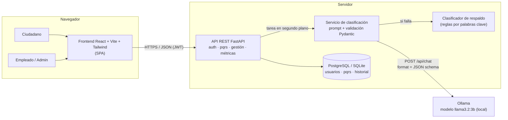
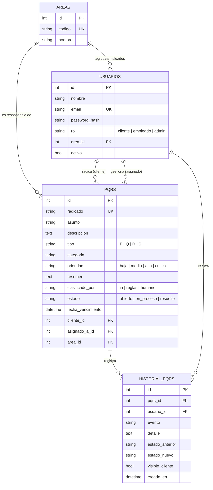
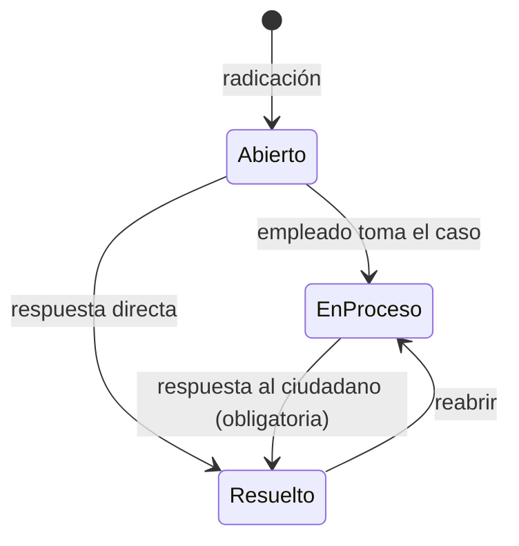

# Arquitectura del prototipo

## 1. Vista de componentes



## 2. Secuencia: radicación y clasificación

```mermaid
sequenceDiagram
    actor Ciudadano
    participant FE as Frontend
    participant API as API FastAPI
    participant BD as Base de datos
    participant IA as Ollama (Llama)

    Ciudadano->>FE: Escribe asunto y descripción
    FE->>API: POST /api/pqrs (JWT)
    API->>BD: Guarda PQRS + radicado + evento "creada"
    API-->>FE: 201 Created (estado_ia = pendiente)
    Note over API: La respuesta es inmediata;<br/>la IA trabaja en segundo plano
    API->>IA: Prompt + texto delimitado + esquema JSON
    IA-->>API: {tipo, categoria, prioridad, resumen, justificacion}
    API->>API: Valida contra el catálogo · deriva el área · aplica salvaguardas
    API->>BD: Guarda clasificación + eventos "clasificada" y "asignada"
    loop cada 2 s mientras esté pendiente
        FE->>API: GET /api/pqrs/{id}
    end
    FE-->>Ciudadano: Tipo, área responsable y plazo de respuesta
```

## 3. Modelo entidad-relación



## 4. Máquina de estados de una PQRS



## 5. Decisiones de diseño

| Decisión | Por qué |
|---|---|
| El modelo solo elige de listas cerradas y el **backend** deriva el área desde la categoría | Una alucinación no puede enviar un caso a un área que no existe (riesgo #1 de la matriz). |
| Salida forzada con `format` (JSON schema) + validación Pydantic + 1 reintento | La respuesta siempre es parseable o se descarta (criterio de aceptación 3). |
| Clasificación en **segundo plano** | En CPU el modelo puede tardar varios segundos; el ciudadano recibe su radicado al instante. |
| **Clasificador por reglas** de respaldo | Si Ollama está apagado o el hardware no da (riesgo #2), ninguna PQRS queda sin clasificar. |
| **Salvaguarda de prioridad**: palabras como *tutela*, *fraude* o *riesgo* nunca quedan por debajo de "crítica" | Un error del modelo no puede esconder un caso urgente. |
| El texto del ciudadano va entre delimitadores y se le quitan las etiquetas | Mitiga la inyección de instrucciones (*prompt injection*). |
| El resumen oculta números largos (cédulas, tarjetas, teléfonos) | Minimiza datos personales visibles (Ley 1581 de 2012). |
| Historial con `visible_cliente` | Trazabilidad completa para auditoría; el ciudadano solo ve lo que le corresponde. |
| Corrección humana registrada como evento | La IA asiste, el humano decide; además permite medir la tasa de error real del modelo. |
